# M2 — Architecture Design v1: ShopHub

> Mốc M2 (tuần 8). Thiết kế này là bản v1, sẽ được đánh giá bằng ATAM ở M3 và sửa thành v2.
> Mọi lựa chọn trong tài liệu này phải truy vết được về ASR ở M1. Nếu một lựa chọn không giúp đạt ASR nào, nó không có chỗ trong thiết kế này.

## 1. Phân rã theo Domain-Driven Design (bounded context)

ShopHub không được chia theo bảng dữ liệu hay theo màn hình, mà chia theo bounded context — mỗi context có ngôn ngữ nghiệp vụ, aggregate và quy tắc nhất quán riêng.

| Bounded context | Trách nhiệm | Aggregate chính | Domain event chính |
|---|---|---|---|
| Catalog | Sản phẩm, danh mục, tìm kiếm, hiển thị | Product, Category | ProductCreated, ProductUpdated, ProductPriceChanged |
| Ordering | Giỏ hàng, đơn hàng, luồng đặt hàng | Order, Cart | OrderCreated, OrderConfirmed, OrderCancelled |
| Inventory | Tồn kho, trừ kho, hoàn kho, flash sale | Stock, FlashSaleStock | StockReserved, StockReleased, StockDepleted |
| Payment | Thanh toán, hoàn tiền, đối soát thanh toán | Payment, Refund | PaymentSucceeded, PaymentFailed, RefundIssued |
| Shipping | Vận chuyển, bàn giao, trạng thái giao hàng | Shipment | ShipmentCreated, ShipmentDelivered |
| Seller | Gian hàng, hồ sơ người bán, doanh thu | Shop, SellerPayout | ShopRegistered, PayoutCalculated |
| Review | Đánh giá sản phẩm và người bán | Review | ReviewSubmitted |

**Quy tắc biên:**

- Ordering không được tự ý sửa tồn kho bằng cách ghi trực tiếp vào bảng của Inventory. Ordering gửi yêu cầu trừ kho, Inventory là nơi duy nhất quyết định trừ kho thành công hay không.
- Payment không được tự ý xác nhận đơn. Payment chỉ phát ra event thanh toán thành công hoặc thất bại, Ordering mới là nơi quyết định trạng thái đơn.
- Catalog không chứa logic tồn kho. Số lượng hiển thị trên trang sản phẩm là dữ liệu đọc từ Inventory qua cache hoặc event, không phải nguồn sự thật của tồn kho.

## 2. Kết quả Event Storming (tóm tắt)

Buổi Event Storming của nhóm (theo hướng dẫn: 2 giờ, giấy note hoặc Miro, chụp ảnh kết quả đưa vào báo cáo) đi theo chuỗi sau. Nhóm phải thay phần tóm tắt này bằng ảnh và ghi chú thật của buổi làm việc của mình trước khi nộp.

**Chuỗi sự kiện chính:**

1. `ProductListed` → khách tìm kiếm → `ProductViewed`
2. `CartItemAdded` → khách đặt hàng → `OrderCreated`
3. `OrderCreated` → Inventory nhận lệnh → `StockReserved` hoặc `StockOutOfStock`
4. `StockReserved` → Payment nhận lệnh → `PaymentSucceeded` hoặc `PaymentFailed`
5. `PaymentSucceeded` → `OrderConfirmed` → Shipping nhận lệnh → `ShipmentCreated`
6. `PaymentFailed` → `StockReleased` (bù trừ) → `OrderCancelled`
7. `ShipmentDelivered` → khách đánh giá → `ReviewSubmitted`
8. Cuối ngày: `PayoutCalculated` từ các đơn đã giao thành công và đã trừ hoàn tiền

**Từ event sang command và aggregate:**

| Command | Aggregate nhận | Event phát ra |
|---|---|---|
| CreateOrder | Order | OrderCreated |
| ReserveStock | Stock | StockReserved / StockOutOfStock |
| ChargePayment | Payment | PaymentSucceeded / PaymentFailed |
| ReleaseStock (bù trừ) | Stock | StockReleased |
| CreateShipment | Shipment | ShipmentCreated |
| SubmitReview | Review | ReviewSubmitted |

**Bài học từ Event Storming:**

- Luồng đặt hàng không phải một transaction duy nhất, mà là một chuỗi bước có thể thất bại ở từng bước. Vì vậy Saga là bắt buộc, không phải lựa chọn trang trí.
- Tồn kho và thanh toán là hai điểm dễ mất nhất quán nhất, nên chúng phải có bước bù trừ rõ ràng, không được dựa vào hy vọng là bước sau sẽ thành công.

## 3. C4 — Level 1: Context

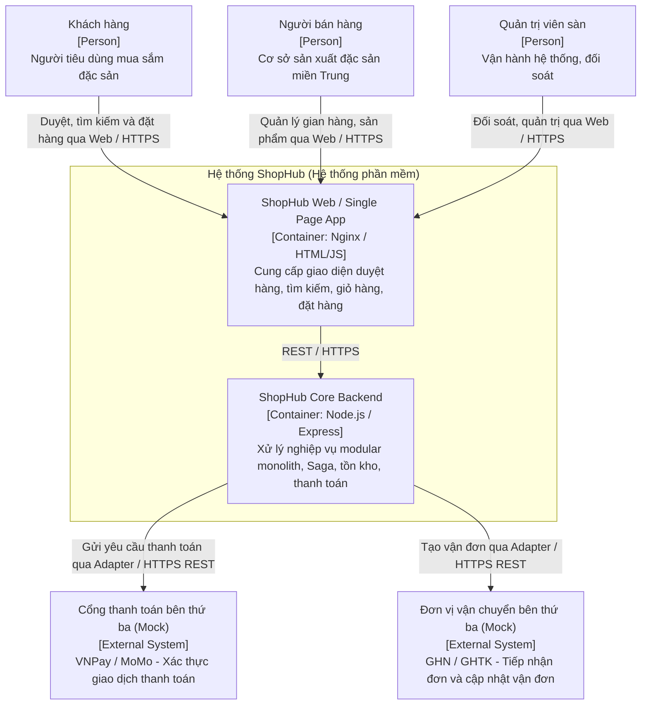

**Legend — Context View:**
- **Person (Khách hàng, Người bán, Quản trị viên):** Người dùng trực tiếp tương tác với hệ thống qua trình duyệt.
- **ShopHub Boundary:** Ranh giới phạm vi phần mềm ShopHub được xây dựng.
- **External System (PayGW, ShipProv):** Hệ thống độc lập của đối tác bên ngoài, tích hợp qua mạng Internet bằng giao thức chuẩn HTTPS/REST và được bọc qua lớp Adapter nội bộ.
- **Mũi tên:** Hướng luồng gọi và giao thức truyền tải dữ liệu.

---

## 4. C4 — Level 2: Container

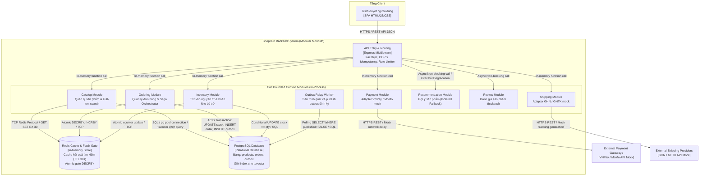

**Legend — Container View:**
- **Client Container:** Ứng dụng giao diện web chạy trên trình duyệt client.
- **Backend Modules (Modular Monolith):** Các module nghiệp vụ nằm chung trong 1 tiến trình Node.js, giao tiếp thông qua module interface hoặc in-memory function calls, tách biệt ranh giới dữ liệu và nghiệp vụ.
- **Data Stores:**
  - `PostgreSQL`: Nguồn sự thật (Single Source of Truth), quản lý giao dịch ACID, bảng dữ liệu đơn hàng, kho hàng và hàng đợi Outbox.
  - `Redis`: Bộ đệm dữ liệu tìm kiếm và cổng chắn lưu lượng flash sale nguyên tử (`DECRBY`).
- **External Dependencies:** Dịch vụ mock mô phỏng đối tác ngoài, tích hợp thông qua Adapter.
- **Đường nét đứt / Mũi tên cam:** Cuộc gọi bất đồng bộ, có cơ chế cách ly lỗi (Bulkhead / Circuit Breaker) không làm nghẽn luồng chính.

---

## 5. C4 — Level 3: Component

### 5.1. Ordering Component

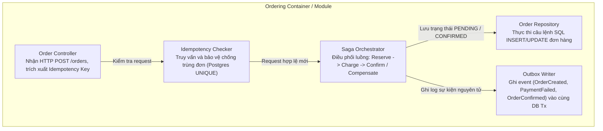

**Legend — Ordering Component:**
- `Order Controller`: Tầng đón nhận HTTP REST API từ Client.
- `Saga Orchestrator`: Thành phần trung tâm điều phối trạng thái của chuỗi giao dịch phân tán.
- `Idempotency Checker`: Đảm bảo mỗi request chỉ sinh ra đúng 1 đơn hàng duy nhất.
- `Outbox Writer`: Đảm bảo tính nhất quán giữa trạng thái đơn và sự kiện nghiệp vụ phát đi.

### 5.2. Inventory Component

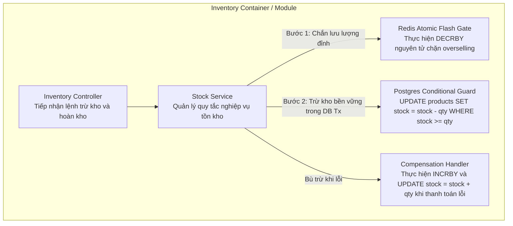

**Legend — Inventory Component:**
- `Redis Atomic Flash Gate`: Tuyến phòng thủ số 1 cho flash sale, xử lý cực nhanh trên RAM.
- `Postgres Conditional Guard`: Tuyến phòng thủ số 2 bền vững, chống lệch đồng bộ và bảo đảm ACID.
- `Compensation Handler`: Khôi phục số lượng kho về nguyên trạng khi xảy ra lỗi thanh toán.

### 5.3. Catalog & Search Component

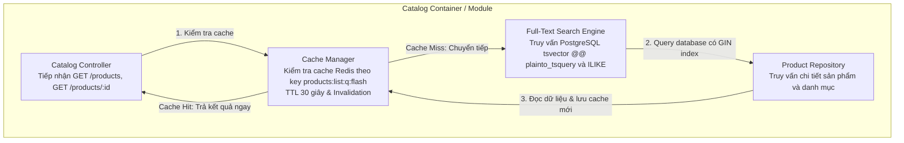

**Legend — Catalog Component:**
- `Cache Manager`: Giảm tải cho cơ sở dữ liệu đối với 90% truy vấn đọc trong giờ cao điểm.
- `Search Engine`: Tận dụng PostgreSQL Full-text Search với chỉ mục GIN, đáp ứng $p95 < 500$ ms mà không cần vận hành cụm Elasticsearch cồng kềnh ở giai đoạn đầu.

### 5.4. Payment Component

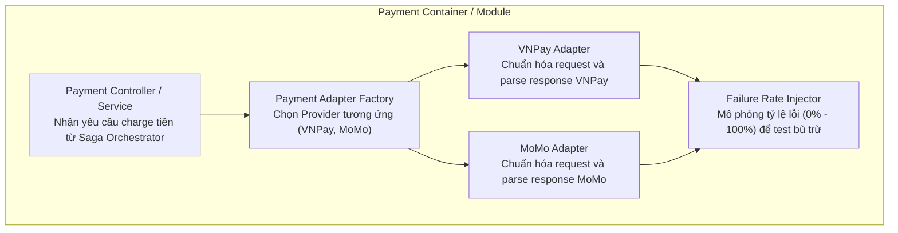

**Legend — Payment Component:**
- Áp dụng mẫu thiết kế Adapter: Mọi cổng thanh toán đều tuân thủ cùng interface `charge(amount) -> { ok, transactionId, error }`.
- Việc bổ sung một cổng thanh toán mới (như ZaloPay) chỉ cần thêm 1 file adapter tuân thủ interface mà không sửa code của Saga.

### 5.5. Shipping Component

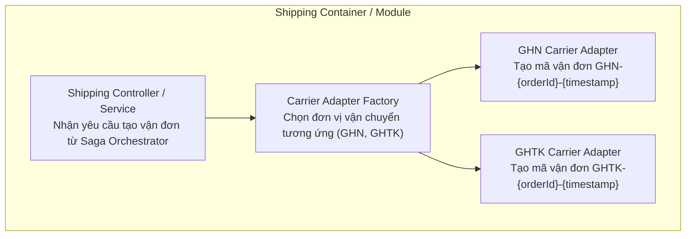

**Legend — Shipping Component:**
- Áp dụng mẫu thiết kế Adapter: Mọi đơn vị vận chuyển đều tuân thủ cùng interface `createShipment(order) -> { ok, carrier, trackingCode, estimatedDays }`.
- Đảm bảo đạt chỉ tiêu QA4 (thêm carrier mới trong $\le 3$ ngày công, sửa 0 file cốt lõi).

## 6. Deployment view

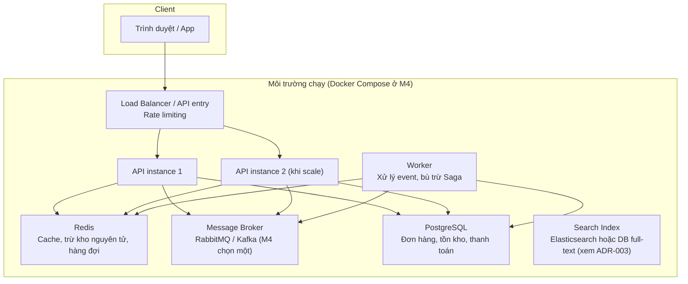

**Giải thích deployment:**

- Tầng API có thể tăng số instance mà không đổi code — đây là cách đạt mục tiêu scale-out ở QA7.
- Redis giữ hai vai trò khác nhau và phải tách rõ trong báo cáo: cache cho đường đọc, và cơ chế trừ kho nguyên tử + hàng đợi cho flash sale.
- Worker xử lý event bất đồng bộ và bước bù trừ Saga, để luồng đặt hàng không bị chặn bởi các bước chậm.
- Ở M4, toàn bộ deployment này phải chạy được bằng `docker compose up`. Nếu nhóm chỉ chạy được trên một máy, báo cáo phải ghi rõ môi trường kiểm chứng và không kết luận đã đạt 5.000 request/giây.

## 7. Sequence diagram — Luồng đặt hàng bằng Saga (orchestration)

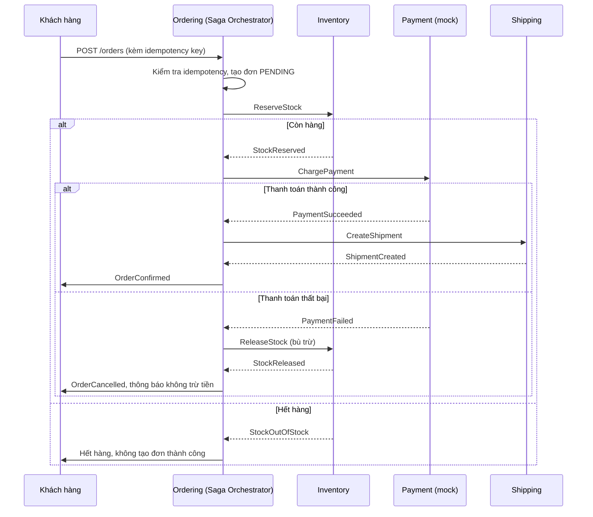

**Điểm phải giải thích được khi vấn đáp:**

- Vì sao chọn orchestration thay vì choreography: một orchestrator nhìn thấy toàn bộ trạng thái Saga, dễ viết bước bù trừ và dễ truy vết khi đơn kẹt ở một bước. Xem ADR-002.
- Vì sao không dùng transaction 2PC xuyên suốt các service: 2PC khóa tài nguyên lâu, không chịu được tải flash sale, và không phù hợp khi một bước là gọi cổng thanh toán ngoài.
- Khi Payment trả lỗi, điều gì xảy ra với tồn kho: bước bù trừ `ReleaseStock` phải chạy, và phải có log để chứng minh tồn kho đã trở về đúng số.

## 8. Sequence diagram — Flash sale trừ kho

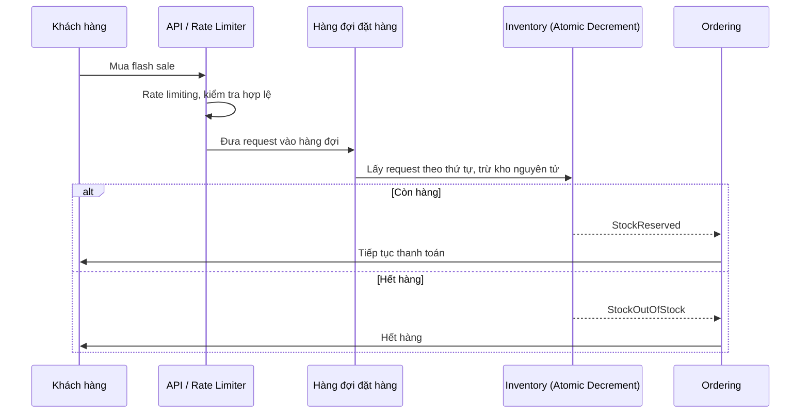

**Điểm phải giải thích được:**

- Vì sao trừ kho phải là nguyên tử: nếu đọc rồi trừ bằng hai bước, hai request đồng thời có thể cùng đọc số lượng 1 và cùng trừ, dẫn tới bán vượt kho.
- Vì sao cần hàng đợi: hàng đợi san phẳng đỉnh tải (queue-based load leveling), để hệ thống xử lý theo khả năng thật thay vì sập khi tất cả request ập tới cùng lúc.
- Nếu Redis sập giữa flash sale, tồn kho khôi phục từ đâu: nguồn sự thật cuối cùng là database, Redis là lớp tăng tốc và trừ kho nguyên tử; báo cáo phải nêu rõ cơ chế đồng bộ lại và giới hạn của nó, không được khẳng định Redis là nguồn sự thật duy nhất mà không có cơ chế khôi phục.

## 9. Patterns và tactics theo ASR

| ASR | Pattern / tactic chính | Tactic phụ và trade-off |
|---|---|---|
| ASR1 — Không bán vượt kho | Atomic decrement, queue-based load leveling, rate limiting | Trade-off: khách phải chờ trong hàng đợi; cần thông báo rõ trạng thái, không để khách nghĩ là hệ thống treo |
| ASR2 — Saga có bù trừ | Saga orchestration, Outbox pattern, idempotency key, compensation | Trade-off: nhất quán cuối cùng (eventual consistency), không phải nhất quán mạnh ngay lập tức; giao diện phải thể hiện trạng thái đơn trung gian một cách trung thực |
| ASR3 — p95 tìm kiếm và đặt hàng | Cache cho đường đọc, search index, tách đường đọc và đường ghi, scale-out tầng API | Trade-off: cache có thể cũ; cần chiến lược invalidation rõ ràng, đặc biệt với giá và tồn kho hiển thị |
| ASR4 — Dịch vụ phụ lỗi không chặn luồng chính | Tách Recommendation và Review khỏi luồng chính, circuit breaker, fallback (ẩn gợi ý thay vì lỗi trang), bulkhead | Trade-off: khi dịch vụ phụ lỗi, trải nghiệm bị giảm (không có gợi ý), nhưng luồng đặt hàng vẫn sống — đây là trade-off có chủ đích |

## 10. Những gì M2 chưa quyết và phải quyết ở M3

- Broker cụ thể ở M4 là RabbitMQ hay Kafka, dựa trên tiêu chí đã nêu trong ADR-001 và ADR-002, không chọn theo cảm tính.
- Search index cụ thể là DB full-text hay Elasticsearch, dựa trên ADR-003 và khối lượng dữ liệu kiểm chứng.
- Cách đo p95 và throughput ở M4, bao gồm môi trường máy chạy, số lượng request, và cách tránh kết luận quá mức từ kết quả trên laptop.
- Ít nhất 2 risk từ ATAM ở M3 sẽ được sửa trong Design v2, kèm ADR cập nhật trạng thái nếu quyết định thay đổi.

---

## 11. Tiến hóa lên Architecture Design v2 (Xử lý rủi ro từ ATAM M3)

Sau quá trình đánh giá kiến trúc ATAM tại mốc M3 và ghi nhận phản hồi phản biện (Peer Review), hai rủi ro kiến trúc trọng yếu đã được xác định và giải quyết triệt để trong **Architecture Design v2**:

### 11.1. Xử lý Risk R1: Lệch pha hoặc sự cố Redis trong Flash Sale (ASR1 - QA1)
- **Vấn đề v1:** Nếu Redis gặp sự cố (restart/crash) trong khi đang diễn ra đợt flash sale, bộ đếm RAM bị xóa hoặc không đồng bộ với PostgreSQL, có thể dẫn đến việc từ chối nhầm khách hàng hoặc bán vượt kho nếu chỉ dựa vào Redis.
- **Giải pháp v2 (Dual-Gate & Resync Protocol):**
  1. **PostgreSQL là Single Source of Truth:** Mọi lệnh trừ kho quyết định cuối cùng đều phải vượt qua `UPDATE products SET stock = stock - $qty WHERE id = $id AND stock >= $qty`. Nếu Postgres từ chối, transaction rollback ngay lập tức.
  2. **Reconciliation & Auto Resync:** Bổ sung cơ chế `syncFlashStockFromDb()` khi hệ thống khởi động và API endpoint đối soát `POST /admin/sync-flash-stock` cho phép đồng bộ cưỡng bức giá trị từ PostgreSQL sang Redis khi phát hiện sai lệch.
  3. **ADR bổ sung:** Ban hành [ADR-012](file:///d:/ShopHub/docs/ADR/ADR-012.md) quy định chiến lược khắc phục sự cố Redis Gate & Single Source of Truth.

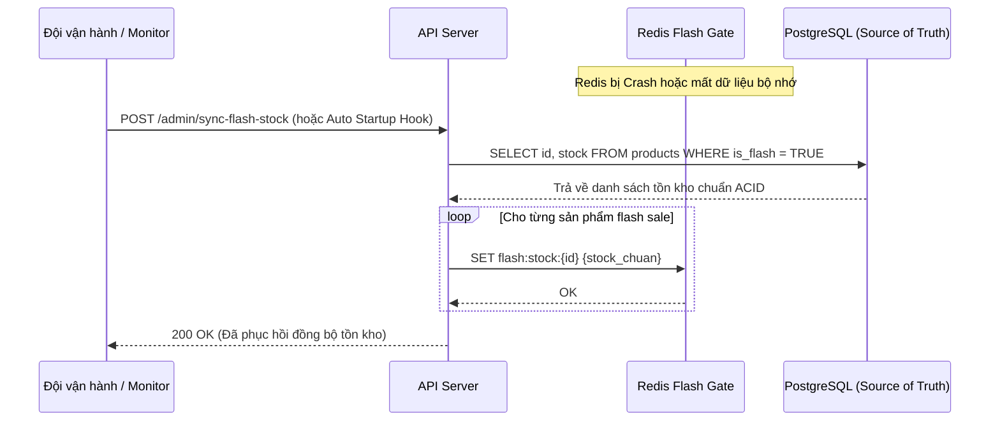

### 11.2. Xử lý Risk R2: Bước bù trừ Saga bị kẹt hoặc lỗi mạng giữa chừng (ASR2 - QA2)
- **Vấn đề v1:** Nếu tiến trình API bị sập đột ngột (crash/OOM) đúng vào thời điểm cổng thanh toán trả về lỗi nhưng trước khi bước bù trừ `ReleaseStock` kịp hoàn tất, đơn hàng sẽ bị kẹt ở trạng thái `RESERVED`, làm rò rỉ tồn kho của người bán.
- **Giải pháp v2 (Stuck Saga Recovery Worker & Compensation Idempotency):**
  1. **Background Recovery Scanner:** Bổ sung một worker chạy định kỳ (mỗi 10–30 giây) quét các đơn hàng ở trạng thái `RESERVED` có thời gian tạo vượt quá timeout thanh toán (ví dụ: > 60 giây).
  2. **Tự động kích hoạt bù trừ:** Quét kiểm tra trạng thái thanh toán; nếu không có giao dịch thành công hợp lệ, worker tự động chạy bù trừ hoàn kho trong Postgres và Redis, chuyển đơn sang `PAYMENT_FAILED` và ghi outbox event `SagaAutoCompensated`.
  3. **Tính Idempotent của bù trừ:** Sử dụng cập nhật có điều kiện `WHERE id = $id AND status = 'PENDING'` để đảm bảo dù worker quét nhiều lần thì tồn kho chỉ được hoàn trả đúng 1 lần duy nhất.
  4. **ADR bổ sung:** Ban hành [ADR-011](file:///d:/ShopHub/docs/ADR/ADR-011.md) quy định cơ chế quét Saga kẹt và bảo đảm tính Idempotent cho bù trừ.

```mermaid
sequenceDiagram
    participant W as Stuck Saga Recovery Worker
    participant DB as PostgreSQL
    participant Redis as Redis Gate
    participant Outbox as Outbox Queue

    loop Định kỳ mỗi 30 giây
        W->>DB: SELECT * FROM orders WHERE status='PENDING' AND saga_step='RESERVED' AND created_at < NOW() - INTERVAL '60s'
        alt Phát hiện đơn bị kẹt
            DB-->>W: Danh sách đơn hàng timeout kẹt bước thanh toán
            loop Từng đơn kẹt
                W->>DB: BEGIN Tx: UPDATE products SET stock = stock + qty; UPDATE orders SET status='PAYMENT_FAILED', saga_step='AUTO_COMPENSATED';
                DB-->>W: Commit thành công
                W->>Redis: INCRBY flash:stock:{productId} qty
                W->>Outbox: INSERT INTO outbox ('SagaAutoCompensated', orderId)
            end
        else Không có đơn kẹt
            DB-->>W: Danh sách rỗng
        end
    end
```

### 11.3. Bảng so sánh tiến hóa giữa Architecture Design v1 và v2

| Tiêu chí | Design v1 (M2) | Design v2 (Sau ATAM M3) | Lợi ích đạt được |
|---|---|---|---|
| **Xử lý kẹt Saga (QA2)** | Bù trừ inline đồng bộ trong request | Bổ sung Background Recovery Worker quét đơn kẹt quá 60s | Triệt tiêu hoàn toàn rò rỉ tồn kho khi server crash giữa chừng |
| **Bảo đảm Redis Gate (QA1)** | Ghi đè đơn lẻ khi seed | Thêm endpoint và startup hook đối soát cưỡng bức từ DB | Phục hồi nhanh sau sự cố sập cache mà không lệch số liệu |
| **Outbox Broker (ASR4)** | In-process timer relay mẫu | Chuẩn hóa interface OutboxPublisher sẵn sàng tích hợp Message Broker ngoài | Sẵn sàng mở rộng kiến trúc khi tải tăng 10 lần |
| **ADR đi kèm** | ADR-001 đến ADR-010 | Thêm ADR-011 (Recovery Saga) và ADR-012 (Dual-gate Redis Resync) | Hoàn thiện tài liệu kiến trúc có tính truy vết cao |
