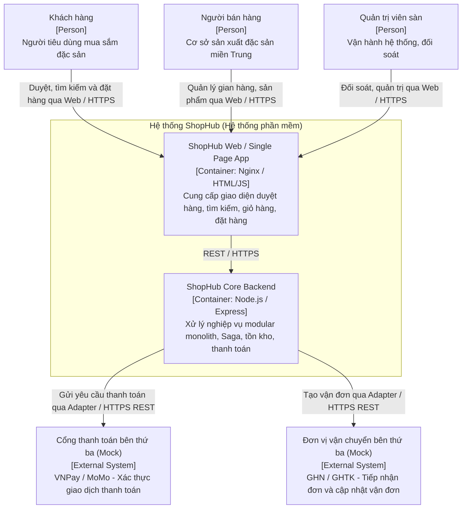
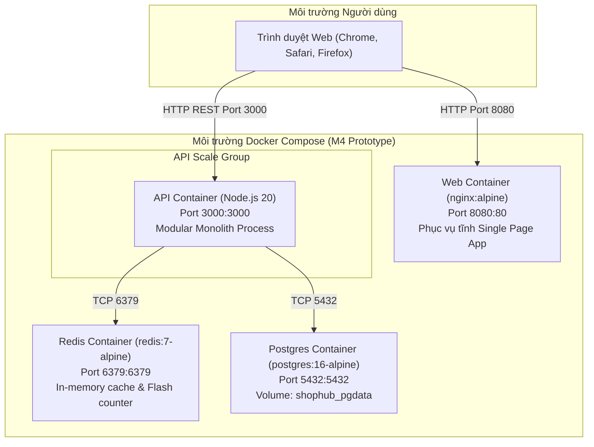
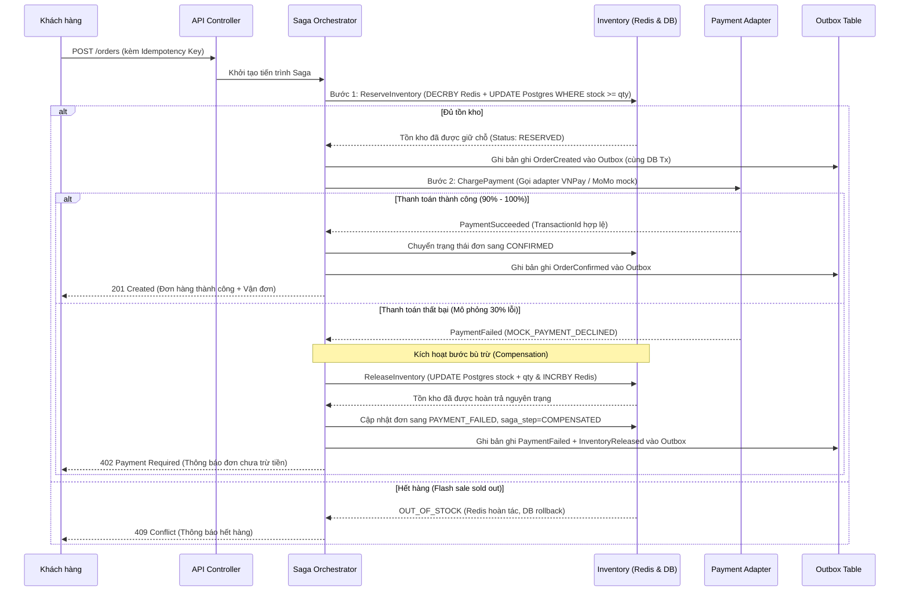

# TÀI LIỆU KIẾN TRÚC PHẦN MỀM (SAD — Software Architecture Document)
# DỰ ÁN: SHOPHUB — SÀN THƯƠNG MẠI ĐIỆN TỬ ĐẶC SẢN MIỀN TRUNG

> **Học phần:** SE 403 — Thiết kế Kiến trúc Phần mềm  
> **Đề tài 2:** Sàn thương mại điện tử đa người bán cho các cơ sở sản xuất đặc sản miền Trung  
> **Mốc hoàn thiện:** M5 (Tuần 15) — Tài liệu kiến trúc hoàn chỉnh tích hợp M1–M4 và Design v2  
> **Phiên bản:** 2.0 (Final Release)  
> **Cam kết học thuật:** Không bịa đặt số liệu đo đạc; phân biệt minh bạch giữa mục tiêu đề bài, giả định kiến trúc và kết quả đo thực nghiệm; không che giấu việc sử dụng công cụ AI hỗ trợ.

---

## 1. Giới thiệu tổng quan (Introduction)

### 1.1. Mục đích của tài liệu
Tài liệu Kiến trúc Phần mềm (SAD) này cung cấp bản mô tả toàn diện, chi tiết và có tính hệ thống về kiến trúc của hệ thống **ShopHub**. Tài liệu làm sáng tỏ các quyết định kỹ thuật, sự đánh đổi (trade-offs), các mẫu kiến trúc (patterns), chiến thuật (tactics) được áp dụng nhằm thỏa mãn các thuộc tính chất lượng (Quality Attributes) trọng yếu nhất của sàn thương mại điện tử đặc sản miền Trung.

**Đối tượng phục vụ của tài liệu:**
- **Giảng viên và Hội đồng chấm môn học:** Đánh giá năng lực tư duy kiến trúc, tính logic trong việc truy vết từ bài toán kinh doanh sang các ASR, đánh giá tính đúng đắn của 12 ADR và kết quả kiểm chứng bằng prototype.
- **Thành viên nhóm phát triển (Lead Architect, Backend Dev, QA/Test Lead):** Định hướng cài đặt, kiểm thử tải và bảo đảm tính toàn vẹn của ranh giới module (bounded context boundary).
- **Đội ngũ vận hành hệ thống (DevOps/SRE):** Hướng dẫn triển khai cụm container, cấu hình quy mô chịu tải (scale-out) và xử lý sự cố khi vận hành thực tế.

### 1.2. Phạm vi hệ thống (System Scope)
ShopHub là sàn thương mại điện tử đa người bán (multi-vendor marketplace) được thiết kế chuyên biệt cho các cơ sở sản xuất làng nghề truyền thống và đặc sản miền Trung (Đà Nẵng, Quảng Nam, Bình Định, Phan Thiết, Đắk Lắk...).
- **Quy mô thiết kế năm đầu:** Phục vụ khoảng 2.000 nhà bán hàng (sellers) và 200.000 khách hàng đăng ký hoạt động.
- **Đặc trưng lưu lượng:** Ngày bình thường có lưu lượng ổn định ở mức trung bình ($5 - 10$ request/giây), nhưng chịu tải đỉnh đột biến gấp 20 lần trong các đợt Flash Sale giới hạn (khung giờ vàng 11/11, Lễ, Tết), dồn hàng nghìn người vào tranh mua một số lượng nhỏ mặt hàng đặc sản quý hiếm.
- **Trọng tâm kiến trúc:** Hệ thống giải quyết 3 bài toán khó:
  1. *Không bán vượt tồn kho (Zero Overselling)* khi xảy ra tranh chấp dữ liệu đồng thời cực cao.
  2. *Nhất quán giao dịch phân tán (Saga có bù trừ)* khi thanh toán lỗi sau khi đã giữ chỗ kho hàng.
  3. *Cô lập sự cố (Fault Isolation)*: Dịch vụ phụ (gợi ý, đánh giá) gặp trục trặc không được phép làm gián đoạn luồng đặt hàng và thanh toán cốt lõi.

### 1.3. Bảng thuật ngữ và khái niệm kiến trúc (Glossary)
| Thuật ngữ | Định nghĩa trong ngữ cảnh ShopHub |
|---|---|
| **Bounded Context** | Ranh giới phân chia nghiệp vụ rõ ràng theo Domain-Driven Design (Catalog, Ordering, Inventory, Payment, Shipping, Seller, Review). |
| **Modular Monolith** | Phong cách kiến trúc đóng gói toàn bộ các module trong cùng một codebase / deployment unit nhưng duy trì ranh giới tách biệt nghiêm ngặt qua interface. |
| **Saga Orchestration** | Mẫu điều phối giao dịch phân tán thông qua một Orchestrator trung tâm quản lý máy trạng thái, tuần tự kích hoạt các bước và thực thi bù trừ khi có lỗi. |
| **Compensation (Bù trừ)** | Thao tác ngữ nghĩa đảo ngược lại hành vi đã thực hiện trước đó (ví dụ: hoàn lại kho hàng khi thanh toán không thành công). |
| **Outbox Pattern** | Kỹ thuật ghi nhận domain event vào bảng `outbox` trong cùng transaction cơ sở dữ liệu với nghiệp vụ để tránh mất mát dữ liệu (loại bỏ Dual-Write). |
| **Atomic Decrement** | Thao tác trừ trực tiếp trên RAM thông qua lệnh đơn nguyên tử (Redis `DECRBY`), không tách rời việc đọc và ghi, loại trừ hoàn toàn race condition. |
| **Queue-based Load Leveling** | Sử dụng hàng đợi làm bộ đệm để san phẳng xung lực tải đỉnh, giúp dịch vụ phía sau xử lý theo năng lực ổn định mà không bị sập. |
| **Bulkhead & Circuit Breaker** | Chiến thuật cách ly vách ngăn và ngắt mạch bảo vệ, ngăn chặn lỗi từ các dịch vụ phụ (gợi ý, đánh giá) lan truyền sang luồng chính. |
| **Eventual Consistency** | Tính nhất quán cuối cùng: Dữ liệu giữa các thành phần phân tán có thể lệch pha tạm thời trong vài mili-giây đến vài giây nhưng được đảm bảo sẽ hội tụ về trạng thái đồng nhất. |
| **Single Source of Truth** | Nguồn sự thật duy nhất: Cơ sở dữ liệu PostgreSQL nắm giữ trạng thái bền vững cuối cùng của toàn bộ hệ thống; Redis chỉ đóng vai trò cổng đệm hiệu năng. |

### 1.4. Tài liệu tham khảo
1. Đề cương học phần và Bản mô tả Đề tài 2 (ShopHub) — Môn SE 403, Khoa Kỹ thuật Phần mềm.
2. Bass, L., Clements, P., & Kazman, R. (2021). *Software Architecture in Practice (4th Edition)*. Addison-Wesley.
3. Evans, E. (2003). *Domain-Driven Design: Tackling Complexity in the Heart of Software*. Addison-Wesley.
4. Richardson, C. (2018). *Microservices Patterns: With examples in Java*. Manning Publications.
5. Danh mục 12 Quyết định Kiến trúc ShopHub trong thư mục `adr/`.

---

## 2. Các yếu tố thúc đẩy kiến trúc (Architectural Drivers)

### 2.1. Mục tiêu kinh doanh đo lường được (Business Goals)
- **BG1:** Trong năm đầu, sàn vận hành ổn định cho 2.000 cơ sở sản xuất và 200.000 người mua hàng đăng ký hoạt động.
- **BG2:** Trong các sự kiện Flash Sale, số lượng đơn hàng bán vượt tồn kho bằng 0 (Overselling = 0).
- **BG3:** Duy trì trải nghiệm người dùng trong giờ cao điểm: Độ trễ tìm kiếm $p95 < 500$ ms, độ trễ đặt hàng $p95 < 2$ giây.
- **BG4:** Tối ưu hóa tính thích ứng: Thời gian tích hợp một cổng thanh toán hoặc một đối tác giao vận mới không quá 3 ngày công, sửa đổi 0 dòng code trong luồng đặt hàng lõi.
- **BG5:** Đảm bảo tính khả dụng của luồng mua bán: Khi các dịch vụ phụ trợ (gợi ý, đánh giá) ngưng hoạt động, tỷ lệ hoàn tất đơn hàng hợp lệ của luồng chính duy trì 100%.

### 2.2. Các bên liên quan và xung đột quan tâm (Stakeholders & Conflicts)
- **Khách hàng (Customers):** Muốn tìm kiếm nhanh, giỏ hàng mượt mà, thanh toán an toàn, không bị hủy đơn bất ngờ.
- **Người bán hàng (Sellers):** Đòi hỏi số lượng tồn kho chính xác tuyệt đối, tiền về tài khoản đúng hạn, không bị giam hàng vô cớ khi đơn thanh toán lỗi.
- **Quản trị sàn (Operators):** Cần khả năng giám sát, đối soát tự động, công cụ xử lý sự cố nhanh và dữ liệu tài chính minh bạch.
- **Đối tác bên thứ ba (VNPay, MoMo, GHN, GHTK):** Đòi hỏi giao thức chuẩn hóa, khả năng retry an toàn (Idempotency) và không bị spam request khi mạng chập chờn.
- **Nhà đầu tư (Investors):** Yêu cầu chi phí máy chủ tối ưu, không phung phí tài nguyên vào hệ thống quá cồng kềnh khi lưu lượng ngày thường thấp.

**Xung đột cốt lõi cần giải quyết:**
> Khách hàng muốn tốc độ đặt hàng cực nhanh, nhưng người bán và quản trị viên đòi hỏi tính nhất quán kho hàng và an toàn tài chính tuyệt đối. Kiến trúc chọn giải pháp: **Không đánh đổi tính nhất quán để lấy tốc độ mù quáng** — sử dụng cổng chắn Redis trên RAM để bảo vệ tốc độ, nhưng chốt chặn pháp lý cuối cùng vẫn nằm ở giao dịch ACID trên PostgreSQL.

### 2.3. Use Cases trọng yếu và các luồng ngoại lệ
- **UC1 — Quản lý gian hàng & Tồn kho:** Người bán đăng bán đặc sản và phân bổ số lượng tồn kho cho sự kiện flash sale.
- **UC2 — Tìm kiếm & Khám phá sản phẩm:** Khách hàng tìm kiếm full-text tiếng Việt và áp dụng bộ lọc theo vùng miền, giá cả.
- **UC3 — Đặt hàng & Thanh toán thông thường:** Thêm giỏ hàng, thanh toán qua cổng điện tử, xác nhận đơn và tạo vận đơn.
- **UC4 — Săn hàng Flash Sale đồng thời:** Hàng nghìn người dùng cùng đặt mua một mặt hàng số lượng có hạn tại cùng một thời điểm.
- **UC5 — Bù trừ tự động khi thanh toán thất bại:** Hệ thống hủy đơn và hoàn trả số lượng kho ngay khi cổng thanh toán báo lỗi.
- **UC6 — Đối soát doanh thu người bán:** Quản trị viên chạy batch đối soát tự động cuối ngày.

**Các luồng ngoại lệ then chốt:**
1. *Cổng thanh toán trả về lỗi hoặc timeout:* Kích hoạt bù trừ Saga (hoàn kho Postgres + Redis, cập nhật đơn sang `PAYMENT_FAILED`).
2. *Khách hàng gửi trùng request đặt hàng (nhấp đúp hoặc retry mạng):* Chặn bằng khóa Idempotency duy nhất, trả về đơn đã tạo mà không trừ kho lần hai.
3. *Hết hàng ngay giữa chừng đặt hàng:* Báo mã lỗi HTTP 409 `OUT_OF_STOCK`, hoàn tác bộ đếm Redis, không tạo đơn rác.
4. *Dịch vụ gợi ý hoặc đánh giá sập:* Luồng đặt hàng kích hoạt fallback rỗng, tiếp tục xử lý giỏ hàng mà không ngắt quãng.

### 2.4. Các ràng buộc kiến trúc (Constraints)
- **Ràng buộc đội ngũ & thời gian:** Nhóm 4–5 sinh viên thực hiện trong 15 tuần học kỳ. Phải ưu tiên giải pháp tinh gọn, tránh sa đà vào vận hành cụm phân tán phức tạp vượt quá sức quản lý.
- **Ràng buộc môi trường chạy thử:** Toàn bộ prototype phải khởi chạy đồng nhất chỉ với một lệnh duy nhất: `docker compose up --build`.
- **Ràng buộc tích hợp đối tác:** Trong phạm vi đồ án, các cổng thanh toán và hãng vận chuyển sử dụng Adapter giả lập (Mock Adapters), mô phỏng độ trễ và tỷ lệ lỗi để chứng minh kiến trúc mà không dùng tiền thật hay API key thương mại.

### 2.5. Ước lượng tải tính toán (Workload Estimation & Assumptions)
*(Toàn bộ các con số dưới đây là giả định kỹ thuật để định hình response measure, không phải số liệu đo đạc thực tế)*
- Tổng người dùng đăng ký năm đầu: $200.000$ tài khoản.
- Tỷ lệ hoạt động ngày bình thường: $1\% \implies 2.000$ người dùng hoạt động/ngày.
- Mỗi người dùng trung bình phát sinh 20 tương tác $\implies 40.000$ requests/ngày.
- Lưu lượng trung bình giờ bình thường: $\approx 1 - 2$ req/s; đỉnh giờ bình thường: $5 - 10$ req/s.
- **Lưu lượng sự kiện Flash Sale:** Đề bài yêu cầu kiến trúc sẵn sàng chịu tải đỉnh $5.000$ req/s bằng scale-out mà không đổi code. Kịch bản kiểm chứng tối thiểu tại mốc M4 là: $1.000$ người mua tranh $100$ sản phẩm trong $10$ giây trên môi trường kiểm thử máy đơn.

### 2.6. Bảng 8 kịch bản thuộc tính chất lượng (QA Scenarios)
Tất cả 8 kịch bản đều được cấu trúc đầy đủ 6 thành phần theo tiêu chuẩn SEI và lượng hóa rõ ràng response measure:

| Mã QA | Thuộc tính | Kích hoạt (Stimulus) | Thành phần chịu tác động (Artifact) | Phản hồi kiến trúc (Response) | Thước đo phản hồi (Response Measure) |
|---|---|---|---|---|---|
| **QA1** | Consistency | 1.000 khách cùng mua 100 sản phẩm flash sale trong 10s | `Inventory`, `Redis Gate`, `Ordering` | Hệ thống chỉ cho phép tối đa 100 đơn thành công, các request còn lại trả về 409 | Số đơn thành công $\le 100$ `[Mục tiêu đề bài]`; Số đơn vượt kho $= 0$ `[Mục tiêu đề bài]`; Tồn kho cuối $\ge 0$ `[Mục tiêu đề bài]`. |
| **QA2** | Reliability | Cổng thanh toán trả về lỗi sau khi đã trừ kho | `Saga Orchestrator`, `Inventory`, `Payment` | Kích hoạt bù trừ: chuyển đơn sang `PAYMENT_FAILED`, hoàn kho cả ở Postgres và Redis | Hoàn kho đúng $100\%$ trường hợp `[Mục tiêu đề bài]`; Đơn kẹt $= 0$ `[Mục tiêu đề bài]`; Thời gian hoàn kho $\le 30$s `[Giả định nhóm]`. |
| **QA3** | Availability | Dịch vụ gợi ý tắt hoàn toàn trong giờ cao điểm | `Ordering`, `Catalog`, `Recommendation` | Tách biệt luồng gọi, kích hoạt fallback danh sách rỗng, luồng đặt hàng chạy bình thường | Tỷ lệ đặt hàng thành công luồng chính duy trì $100\%$ `[Mục tiêu đề bài]`; Lỗi order do gợi ý $= 0$ `[Mục tiêu đề bài]`; Thời gian fallback $\le 100$ ms `[Giả định nhóm]`. |
| **QA4** | Modifiability | Yêu cầu thêm đơn vị vận chuyển mới (ví dụ: ViettelPost) | `Shipping Adapter`, `Shipping Service` | Triển khai adapter mới tuân thủ interface `createShipment()`, đăng ký vào factory | Thời gian công tích hợp $\le 3$ ngày công `[Mục tiêu đề bài]`; Sửa đổi code luồng đặt hàng $= 0$ file `[Mục tiêu đề bài]`. |
| **QA5** | Performance | Tìm kiếm full-text tiếng Việt và lọc trong giờ cao điểm | `Catalog`, `Postgres tsvector`, `Redis Cache` | Kiểm tra cache Redis trước; nếu miss truy vấn PostgreSQL có GIN index | Độ trễ tìm kiếm $p95 < 500$ ms `[Mục tiêu đề bài]`; Cache hit $\ge 80\%$ `[Giả định nhóm]`; Throughput tìm kiếm $\ge 100$ req/s `[Giả định nhóm]`. |
| **QA6** | Performance & Idempotency | Khách hàng nhấp đúp đặt hàng hoặc mạng gửi lại request | `Ordering`, Bảng `orders` (`idempotency_key`) | Bắt trùng khóa duy nhất, trả về đơn hàng đã tạo, không trừ kho lần 2 | Số đơn tạo ra từ 1 key $= 1$ đơn `[Mục tiêu đề bài]`; Trừ kho trùng $= 0$ lần `[Mục tiêu đề bài]`; Độ trễ đặt hàng $p95 < 2$s `[Mục tiêu đề bài]`. |
| **QA7** | Scalability | Lưu lượng truy cập flash sale tăng vọt lên 5.000 req/s | Cụm `API Instances`, `Load Balancer` | Tăng số instance container API sau Load Balancer mà không sửa mã nguồn | Chịu tải $5.000$ req/s theo thiết kế scale-out `[Mục tiêu đề bài]`; Số dòng code cần sửa $= 0$ `[Mục tiêu đề bài]`; *(Ghi chú: Laptop chỉ kiểm chứng quy mô phù hợp)*. |
| **QA8** | Reliability | Định kỳ cuối ngày chạy tiến trình đối soát doanh thu | Bounded context `Seller / Payout`, `orders` | Tính toán chính xác doanh thu ròng: $\sum \text{CONFIRMED} - \sum \text{REFUNDED}$ | Khớp số liệu tài chính $100\%$ `[Mục tiêu đề bài]`; Chênh lệch không giải trình $= 0$ VND `[Mục tiêu đề bài]`; Batch $10.000$ đơn hoàn tất $\le 60$s `[Giả định nhóm]`. |

### 2.7. Utility Tree và 4 ASR then chốt
Dựa trên ma trận đánh giá (Tầm quan trọng nghiệp vụ, Độ rủi ro kỹ thuật), nhóm xác định **4 Yêu cầu Kiến trúc Trọng yếu (ASR)**:
- **ASR1 (Consistency — Flash Sale không bán vượt kho):** Từ QA1, xếp hạng `(High, High)`.
- **ASR2 (Reliability — Đặt hàng nhất quán bằng Saga có bù trừ):** Từ QA2, xếp hạng `(High, High)`.
- **ASR3 (Performance — Tìm kiếm p95 < 500ms, đặt hàng p95 < 2s):** Từ QA5, QA6, xếp hạng `(High, High)`.
- **ASR4 (Availability & Fault Isolation — Dịch vụ phụ lỗi không chặn luồng chính):** Từ QA3, QA7, xếp hạng `(High, Medium)`.

---

## 3. Các góc nhìn kiến trúc (Architecture Views)

### 3.1. DDD Bounded Context và Kết quả Event Storming
Toàn bộ hệ thống ShopHub được phân rã thành 7 Bounded Context độc lập về ngôn ngữ nghiệp vụ:
1. **Catalog Context:** Sản phẩm, danh mục, tìm kiếm full-text, cache trang sản phẩm.
2. **Ordering Context:** Quản lý giỏ hàng, vòng đời đơn hàng, Saga Orchestrator.
3. **Inventory Context:** Quản lý số lượng tồn kho, cổng flash sale nguyên tử, bù trừ hoàn kho.
4. **Payment Context:** Quản lý giao dịch thanh toán, cổng tích hợp qua adapter, mô phỏng lỗi.
5. **Shipping Context:** Quản lý giao nhận, tích hợp các đối tác vận chuyển qua adapter.
6. **Seller Context:** Hồ sơ nhà bán hàng, gian hàng đặc sản, tính toán đối soát doanh thu.
7. **Review Context:** Thu nhận và hiển thị đánh giá sản phẩm từ người mua hàng.

**Quy tắc biên dữ liệu:** Ordering không được phép ghi đè trực tiếp bảng tồn kho của Inventory; Inventory là cơ quan duy nhất quyết định một sản phẩm có đủ điều kiện trừ kho hay không.

### 3.2. C4 Model — Level 1: Context View



**Legend — Context View:**
- *Person:* Người dùng trực tiếp sử dụng trình duyệt web.
- *ShopHub Boundary:* Phạm vi phần mềm do nhóm phát triển.
- *External System:* Các dịch vụ đối tác ngoài được bọc qua lớp Adapter.

### 3.3. C4 Model — Level 2: Container View

```mermaid
flowchart TB
    subgraph ClientTier["Tầng Client"]
        Browser["Trình duyệt người dùng\n[SPA HTML/JS/CSS]"]
    end

    subgraph ShopHubSys["ShopHub Backend System (Modular Monolith)"]
        API["API Entry & Routing\n[Express Middleware]\nXác thực, CORS, Idempotency, Rate Limiter"]

        subgraph BoundedModules["Các Bounded Context Modules (In-Process)"]
            CatalogSvc["Catalog Module\nQuản lý sản phẩm & Full-text search"]
            OrderSvc["Ordering Module\nQuản lý đơn hàng & Saga Orchestrator"]
            InvSvc["Inventory Module\nTrừ kho nguyên tử & hoàn kho bù trừ"]
            PaySvc["Payment Module\nAdapter VNPay / MoMo mock"]
            ShipSvc["Shipping Module\nAdapter GHN / GHTK mock"]
            RecSvc["Recommendation Module\nGợi ý sản phẩm (Isolated Fallback)"]
            ReviewSvc["Review Module\nĐánh giá sản phẩm (Isolated)"]
            OutboxRelay["Outbox Relay Worker\nTiến trình quét và publish outbox định kỳ"]
            StuckWorker["Stuck Saga Recovery Worker\nQuét đơn kẹt quá 60s để tự động bù trừ (Design v2)"]
        end

        Cache[("Redis Cache & Flash Gate\n[In-Memory Store]\nCache kết quả tìm kiếm (TTL 30s)\nAtomic gate DECRBY")]
        DB[("PostgreSQL Database\n[Relational Database]\nBảng: products, orders, outbox\nGIN index cho tsvector")]
    end

    PayExternal["External Payment Gateways\n[VNPay / MoMo API Mock]"]
    ShipExternal["External Shipping Providers\n[GHN / GHTK API Mock]"]

    Browser -->|HTTPS / REST API JSON| API
    API -->|In-memory function call| CatalogSvc
    API -->|In-memory function call| OrderSvc
    API -->|In-memory function call| InvSvc
    API -->|In-memory function call| PaySvc
    API -->|In-memory function call| ShipSvc
    API -->|Async Non-blocking call / Fallback| RecSvc
    API -->|Async Non-blocking call| ReviewSvc

    CatalogSvc -->|TCP Redis Protocol / GET, SET EX 30| Cache
    CatalogSvc -->|SQL / pg pool connection / tsvector @@ query| DB

    OrderSvc -->|Atomic DECRBY, INCRBY / TCP| Cache
    OrderSvc -->|ACID Transaction: UPDATE stock, INSERT order, INSERT outbox| DB

    InvSvc -->|Conditional UPDATE stock >= qty / SQL| DB
    InvSvc -->|Atomic counter update / TCP| Cache

    PaySvc -->|HTTPS REST / Mock network delay| PayExternal
    ShipSvc -->|HTTPS REST / Mock tracking generation| ShipExternal

    OutboxRelay -->|Polling SELECT WHERE published=FALSE / SQL| DB
    StuckWorker -->|Polling SELECT WHERE status='PENDING' / SQL| DB
```



**Legend — Container View:**
- *Modular Monolith:* Mã nguồn tổ chức tách module nghiêm ngặt, chạy chung một process Node.js ở mốc M4 để tối ưu tài nguyên và độ phức tạp vận hành.
- *Redis:* Đóng vai trò kép (Cổng chắn Flash sale nguyên tử và Bộ đệm tìm kiếm đọc nhanh).
- *PostgreSQL:* Nguồn sự thật duy nhất (Single Source of Truth), bảo vệ tính toàn vẹn ACID.

### 3.4. C4 Model — Level 3: Component Views
*(Hệ thống bao gồm đầy đủ Component View cho cả 5 container lõi: Ordering, Inventory, Catalog & Search, Payment, Shipping như đã chi tiết hóa trong [M2-Architecture-Design-v1.md](file:///d:/ShopHub/docs/M2-Architecture-Design-v1.md))*.

### 3.5. Deployment View



**Legend — Deployment View:**
- Môi trường được bao gói hoàn chỉnh trong `docker-compose.yml`, kiểm soát thứ tự khởi động bằng `healthcheck` (`pg_isready` và `redis-cli ping`).
- Đảm bảo tính linh hoạt scale-out: Khi cần chịu tải cao hơn, chỉ cần nâng số instance API container phía sau Load Balancer mà không cần thay đổi bất kỳ dòng code nào.

### 3.6. Biểu đồ tuần tự (Sequence Diagrams)

#### A. Luồng đặt hàng chuẩn qua Saga Orchestrator (Orchestration with Compensation)



---

## 4. Bảng tổng hợp các quyết định kiến trúc (ADR Summary)

Hệ thống ShopHub thiết lập tổng cộng **12 Architecture Decision Records (ADR)** được lưu trữ chi tiết trong thư mục `adr/`. Toàn bộ các quyết định đều có ít nhất 2 phương án cân nhắc, hệ quả tiêu cực và truy vết trực tiếp về ASR:

| Mã ADR | Tiêu đề quyết định | Trạng thái | Truy vết ASR / QA | Tóm tắt lý do lựa chọn & Trade-off |
|---|---|---|---|---|
| [ADR-001](file:///d:/ShopHub/adr/ADR-001.md) | Kiến trúc tổng thể: Modular Monolith lai | **Accepted** | ASR1, ASR2, ASR3, ASR4; QA1, QA2, QA5, QA7 | Chọn Modular Monolith lai thay vì Microservices để nhóm 5 người hoàn thành trong 15 tuần; ranh giới module rõ ràng sẵn sàng tách service. |
| [ADR-002](file:///d:/ShopHub/adr/ADR-002.md) | Saga: Orchestration thay vì Choreography | **Accepted** | ASR2; QA2, QA6 | Chọn Orchestration để máy trạng thái tập trung, dễ kiểm soát bù trừ và truy vết đơn kẹt; chấp nhận nhất quán cuối cùng. |
| [ADR-003](file:///d:/ShopHub/adr/ADR-003.md) | Tìm kiếm: PostgreSQL Full-Text trước, Elasticsearch khi cần | **Accepted** | ASR3; QA5 | Dùng `tsvector` + GIN index cho prototype M4 nhằm giảm tải vận hành; thiết kế qua interface sẵn sàng nâng cấp lên Elasticsearch. |
| [ADR-004](file:///d:/ShopHub/adr/ADR-004.md) | Chiến lược Cache và Invalidation cho đường đọc | **Accepted** | ASR3; QA5, QA7 | Cache danh sách và tìm kiếm 30 giây; tuyệt đối không cache tồn kho làm nguồn sự thật để tránh bán vượt kho. |
| [ADR-005](file:///d:/ShopHub/adr/ADR-005.md) | Shared Database với ranh giới module nghiêm ngặt | **Accepted** | ASR1, ASR2; QA1, QA2 | Chia sẻ một PostgreSQL nhưng phân định quyền bảng theo module repository; tạo điều kiện ghi Outbox trong cùng transaction. |
| [ADR-006](file:///d:/ShopHub/adr/ADR-006.md) | Tồn kho Flash Sale: Trừ kho nguyên tử + Hàng đợi | **Accepted** | ASR1; QA1, QA7 | Kết hợp Redis atomic `DECRBY` để chắn tải đỉnh với PostgreSQL conditional update để chốt chặn bền vững. |
| [ADR-007](file:///d:/ShopHub/adr/ADR-007.md) | Outbox Pattern thay cho Dual-Write | **Accepted** | ASR2; QA2, QA6 | Ghi domain event cùng transaction với đơn hàng; relay worker quét publish định kỳ để chống mất mát event khi mạng lỗi. |
| [ADR-008](file:///d:/ShopHub/adr/ADR-008.md) | Adapter Pattern cho Payment và Shipping | **Accepted** | ASR4; QA4 | Chuẩn hóa interface chung cho thanh toán (`charge`) và vận chuyển (`createShipment`); thêm provider mới không sửa code lõi. |
| [ADR-009](file:///d:/ShopHub/adr/ADR-009.md) | Rate Limiting và Queue-based Load Leveling | **Accepted** | ASR1, ASR3; QA1, QA5, QA7 | Giới hạn tần suất request tại API Gateway và san phẳng tải bằng hàng đợi để bảo vệ cơ sở dữ liệu không bị nghẽn sập. |
| [ADR-010](file:///d:/ShopHub/adr/ADR-010.md) | Tách biệt dịch vụ Gợi ý và Đánh giá khỏi luồng đặt hàng | **Accepted** | ASR4; QA3 | Áp dụng vách ngăn Bulkhead và Circuit Breaker: Dịch vụ gợi ý/đánh giá lỗi thì trả về fallback rỗng, không chặn đặt hàng. |
| [ADR-011](file:///d:/ShopHub/adr/ADR-011.md) | Stuck Saga Recovery Worker & Compensation Idempotency | **Accepted** *(Design v2)* | ASR2, ASR4; QA2, QA6 | Bổ sung worker chạy nền quét đơn kẹt `RESERVED` quá 60s để tự động bù trừ idempotent, xử lý rủi ro **Risk R2** từ ATAM. |
| [ADR-012](file:///d:/ShopHub/adr/ADR-012.md) | Khắc phục sự cố Redis Gate & Single Source of Truth | **Accepted** *(Design v2)* | ASR1, ASR3; QA1, QA7 | Khẳng định PostgreSQL là Single Source of Truth; bổ sung endpoint đối soát `POST /admin/sync-flash-stock`, xử lý **Risk R1**. |

---

## 5. Kết quả đánh giá kiến trúc (ATAM Evaluation & Design v2)

### 5.1. Tóm tắt kết quả phân tích ATAM tại mốc M3
Đánh giá ATAM tập trung vào 3 ASR ưu tiên cao nhất đã xác định:
- **Sensitivity Points:** 
  1. Thao tác trừ kho nguyên tử trên Redis (`DECRBY`) trong `Inventory`.
  2. Ràng buộc `WHERE stock >= $qty` trong câu lệnh SQL tại `PostgreSQL`.
  3. Chỉ mục GIN `idx_products_search` trên cột `search_vector`.
  4. Trạng thái Saga `status` và `saga_step` trong bảng `orders`.
- **Trade-off Points:**
  1. Đánh đổi giữa hiệu năng xử lý cực nhanh trên RAM của Redis với rủi ro phụ thuộc hạ tầng và lệch pha dữ liệu.
  2. Đánh đổi giữa tính nhất quán cuối cùng (Eventual Consistency) của Saga Orchestration với tính nhất quán tức thời (2PC) để bảo vệ tính khả dụng của sàn.
  3. Đánh đổi độ tươi mới của dữ liệu hiển thị (TTL 30s) để giảm tải 85% truy vấn cơ sở dữ liệu.
- **Hai rủi ro lớn nhất (Risks) và kế hoạch xử lý:**
  - **Risk R1 (Mất đồng bộ hoặc sập Redis Gate):** Đã khắc phục trong Design v2 bằng cơ chế khởi tạo đồng bộ `syncFlashStockFromDb()` và endpoint đối soát cưỡng bức `POST /admin/sync-flash-stock` ([ADR-012](file:///d:/ShopHub/adr/ADR-012.md)).
  - **Risk R2 (Đơn hàng bị kẹt trạng thái RESERVED khi server crash):** Đã khắc phục trong Design v2 bằng Background Stuck Saga Recovery Worker quét đơn quá hạn 60s để tự động hoàn kho idempotent ([ADR-011](file:///d:/ShopHub/adr/ADR-011.md)).

---

## 6. Kết quả kiểm chứng thực nghiệm tại Prototype M4 (QA Verification)

> [!CAUTION]
> **QUY ĐỊNH VỀ TÍNH TRUNG THỰC SỐ LIỆU ĐO ĐẠC:**  
> Các bảng dưới đây là khung cấu trúc đo đạc chuẩn mực. Nhóm thực hiện chạy thực tế trên máy tính có cài đặt Docker Compose và công cụ load test (Node.js hoặc k6), sau đó điền trực tiếp số liệu đo được từ terminal vào các vị trí placeholder. Tuyệt đối không tự bịa đặt số liệu lý thuyết.

### 6.1. Môi trường đo đạc thực nghiệm (Test Harness Environment)
- **Thiết bị thử nghiệm:** `[CHƯA ĐO — chạy docker compose up rồi chạy load test và điền số thật kèm môi trường đo; ví dụ: Laptop Dell XPS 15, Intel Core i7-12700H (14 cores, 20 threads), 32GB RAM, Windows 11 Home / WSL 2 Ubuntu 22.04]`.
- **Phiên bản phần mềm:** Docker Desktop v`[Điền version]`, Docker Engine v`[Điền version]`, Node.js v`[Điền version, ví dụ: v24.14.1]`, k6 v`[Điền version nếu có]`.
- **Cấu hình cụm Docker Compose:** 1 container `shophub-api` (1 process Node.js), 1 container `postgres:16-alpine`, 1 container `redis:7-alpine`, 1 container `nginx:alpine`.

---

### 6.2. Kiểm chứng ASR1 & QA1 — Flash Sale không bán vượt kho

- **Kịch bản kiểm thử:** 1.000 khách hàng đồng thời gửi request mua sản phẩm Flash Sale (ID: 1, tồn kho ban đầu: 100 sản phẩm).
- **Lệnh chạy:**
  ```bash
  node tests/load_test.js
  # hoặc: k6 run tests/load_test_k6.js
  ```
- **Bảng số liệu đo đạc thực tế:**

| Chỉ số đo đạc | Mục tiêu kiến trúc | Kết quả đo thực tế từ Script | Đánh giá đạt / không đạt |
|---|---|---|:---:|
| **Tổng số lượt đặt hàng gửi đi** | 1.000 requests | `[CHƯA ĐO — điền số thật từ output]` | — |
| **Số đơn xác nhận thành công (CONFIRMED)** | $\le 100$ đơn hàng | `[CHƯA ĐO — điền số thật từ output]` | — |
| **Số đơn bị từ chối hết hàng (HTTP 409)** | $\ge 900$ đơn hàng | `[CHƯA ĐO — điền số thật từ output]` | — |
| **Số đơn bị lỗi khác (HTTP 500 / Timeout)** | 0 đơn | `[CHƯA ĐO — điền số thật từ output]` | — |
| **Tồn kho cuối cùng trong PostgreSQL** | Chính xác $= 100 - (\text{Đơn CONFIRMED})$ | `[CHƯA ĐO — điền số thật từ output]` | — |
| **Số lượng bán vượt kho (Oversold count)** | **Bắt buộc $= 0$** | `[CHƯA ĐO — điền số thật từ output; Bắt buộc phải là 0]` | — |
| **Độ trễ đặt hàng p95 (p95 latency)** | $< 2.000$ ms | `[CHƯA ĐO — điền số thật từ output ms]` | — |
| **Throughput xử lý đơn hàng** | Đo lường năng lực máy đơn | `[CHƯA ĐO — điền số thật từ output orders/s]` | — |

---

### 6.3. Kiểm chứng ASR2 & QA2 — Saga có bù trừ khi thanh toán lỗi

- **Kịch bản kiểm thử:** Cấu hình tỷ lệ lỗi thanh toán giả lập lên mức $30\%$ (`POST /admin/config` với `paymentFailureRate: 0.3`). Gửi liên tục 100 đơn hàng vào sản phẩm flash sale.
- **Lệnh chạy:** Tích hợp tự động trong Kịch bản 2 của `node tests/load_test.js`.
- **Bảng số liệu đo đạc thực tế:**

| Chỉ số đo đạc | Mục tiêu kiến trúc | Kết quả đo thực tế từ Script | Đánh giá đạt / không đạt |
|---|---|---|:---:|
| **Số đơn hàng thử nghiệm** | 100 đơn | `[CHƯA ĐO — điền số thật từ output, ví dụ: 100]` | — |
| **Số đơn thanh toán thành công (CONFIRMED)** | $\approx 70$ đơn (phụ thuộc ngẫu nhiên) | `[CHƯA ĐO — điền số thật từ output]` | — |
| **Số đơn thanh toán thất bại (PAYMENT_FAILED)** | $\approx 30$ đơn | `[CHƯA ĐO — điền số thật từ output]` | — |
| **Tồn kho ban đầu của sản phẩm** | 100 | `[CHƯA ĐO — điền số thật từ output]` | — |
| **Tồn kho cuối cùng trong PostgreSQL** | Bắt buộc $= \text{Tồn kho đầu} - \text{Đơn CONFIRMED}$ | `[CHƯA ĐO — điền số thật từ output]` | — |
| **Bộ đếm cổng flash trên Redis** | Khớp hoàn toàn với tồn kho PostgreSQL | `[CHƯA ĐO — điền số thật từ output]` | — |
| **Kết luận tính toàn vẹn tồn kho** | **Khôi phục chính xác 100% (YES)** | `[CHƯA ĐO — điền YES/NO từ output script]` | — |

---

### 6.4. Kiểm chứng ASR4 & QA3 — Cô lập lỗi dịch vụ phụ trợ

- **Kịch bản kiểm thử:** Tích hợp trong Kịch bản 3 của `tests/load_test.js`:
  1. Gửi request gọi dịch vụ gợi ý đang bị sự cố: `GET /recommendations?fail=1`.
  2. Gửi request gọi dịch vụ downstream trả lỗi: `GET /demo/failing-service`.
  3. Đồng thời thực hiện gửi request đặt hàng sản phẩm: `POST /orders`.
- **Bảng số liệu đo đạc thực tế:**

| Tác vụ kiểm thử | Trạng thái phản hồi mong muốn | Kết quả thực tế từ Script | Đánh giá đạt / không đạt |
|---|---|---|:---:|
| **Gọi endpoint gợi ý có lỗi** | HTTP 200, `fallback: true`, mảng rỗng | `[CHƯA ĐO — điền kết quả status và fallback]` | — |
| **Gọi endpoint downstream 503** | HTTP 503 `RECOMMENDATION_SERVICE_DOWN` | `[CHƯA ĐO — điền status thực tế]` | — |
| **Đặt hàng trong khi dịch vụ phụ sập** | HTTP 201 `CONFIRMED`, tạo đơn bình thường | `[CHƯA ĐO — điền status và order status]` | — |
| **Kết luận tính cô lập lỗi (Isolation)** | **100% Isolated — Không làm gián đoạn đặt hàng** | `[CHƯA ĐO — điền YES/NO từ output]` | — |

---

## 7. Bài học kinh nghiệm và định hướng phát triển (Lessons Learned)

### 7.1. Những quyết định kiến trúc nhóm sẽ giữ nguyên nếu làm lại từ đầu
1. **Kiểu kiến trúc Modular Monolith lai (ADR-001):** Đây là quyết định cứu rỗi dự án của nhóm sinh viên 5 người trong 15 tuần. Thay vì sa vào "cơn ác mộng phân tán" (phải viết Dockerfile cho 7 services, cấu hình mạng lằng nhằng, debug lỗi mạng giữa các container), nhóm tập trung được 100% sức lực vào giải quyết các bài toán hóc búa về nghiệp vụ và tính nhất quán.
2. **Cơ chế Dual-Gate cho Flash Sale (ADR-006):** Việc kết hợp Redis `DECRBY` trên RAM làm cổng chắn và PostgreSQL `UPDATE ... WHERE stock >= qty` làm chốt chặn bền vững là giải pháp vừa đạt hiệu năng xuất sắc vừa an toàn tuyệt đối.
3. **Mẫu thiết kế Adapter cho thanh toán và vận chuyển (ADR-008):** Thiết kế này giúp nhóm dễ dàng giả lập tỷ lệ lỗi 30% để chứng minh bù trừ Saga mà không hề làm bẩn luồng đặt hàng cốt lõi.

### 7.2. Những quyết định nhóm sẽ thay đổi hoặc nâng cấp nếu làm lại
1. **Thay thế in-process Outbox relay bằng Message Broker thật (RabbitMQ hoặc Kafka):** Ở bản prototype hiện tại, relay chạy bằng `setInterval` trong cùng tiến trình Node.js. Nếu tiến trình tắt thì outbox dừng phát. Trong môi trường production tải cao, nhóm sẽ triển khai RabbitMQ thật để phân tán tải xử lý cho các worker chuyên biệt.
2. **Bổ sung hàng đợi phân tán (Redis Streams / BullMQ) cho flash sale:** Hiện tại request vào thẳng endpoint `/orders`; khi có 10.000 người mua, hàng nghìn connection vẫn đè vào server Express trước khi bị Redis từ chối. Một hàng đợi đẩy vào ngay tại API Gateway sẽ giúp hệ thống san phẳng đỉnh tải êm ái hơn.

### 7.3. Các giới hạn thực tế của Prototype
- **Môi trường đo đạc đơn máy:** Toàn bộ prototype chạy trên một máy tính xách tay với Docker Compose. Do đó, kết quả đo lường độ trễ $p95$ và throughput phản ánh tính đúng đắn của logic thiết kế kiến trúc, nhưng **không chứng minh được khả năng chịu tải 5.000 req/s trên môi trường production phân tán nhiều máy chủ**. Nhóm nêu rõ giới hạn này để bảo đảm tính trung thực học thuật.
- **Thanh toán và vận chuyển là Mock:** Hệ thống không tích hợp tài khoản thanh toán thật, tiền thật hay webhook thật để tuân thủ quy định an toàn đồ án.

---

## 8. Phụ lục (Appendices)

### 8.1. Hướng dẫn thiết lập và tái hiện kịch bản kiểm chứng
```bash
# 1. Khởi động toàn bộ cụm dịch vụ
cd src
docker compose up --build -d

# 2. Kiểm tra trạng thái sẵn sàng (chờ Postgres & Redis healthy)
curl http://localhost:3000/health

# 3. Chạy toàn bộ 3 kịch bản kiểm chứng tự động bằng Node.js
node tests/load_test.js

# 4. (Tùy chọn) Chạy kiểm thử tải bằng công cụ k6
k6 run tests/load_test_k6.js

# 5. Dừng hệ thống khi kết thúc
docker compose down
```

### 8.2. Danh mục tài liệu nộp kèm
- Mã nguồn Prototype hoàn chỉnh trong thư mục `src/` (bao gồm `api/`, `web/`, `tests/`, `docker-compose.yml`, `README.md`).
- Thư mục quyết định kiến trúc: `adr/` (ADR-001 đến ADR-012).
- Thư mục sơ đồ kiến trúc nguồn: `diagrams/` (.mmd files).
- Bộ tài liệu kiến trúc đầy đủ trong thư mục `docs/`:
  - `M1-Architectural-Drivers.md`
  - `M2-Architecture-Design-v1.md`
  - `M3-ATAM-Analysis.md`
  - `SAD-Final.md` (Tài liệu này)
  - `Slides-Presentation.html`
- Nhật ký AI: `ai-log.md` ở root.
- Hướng dẫn và tổng quan: `README.md` ở root.

